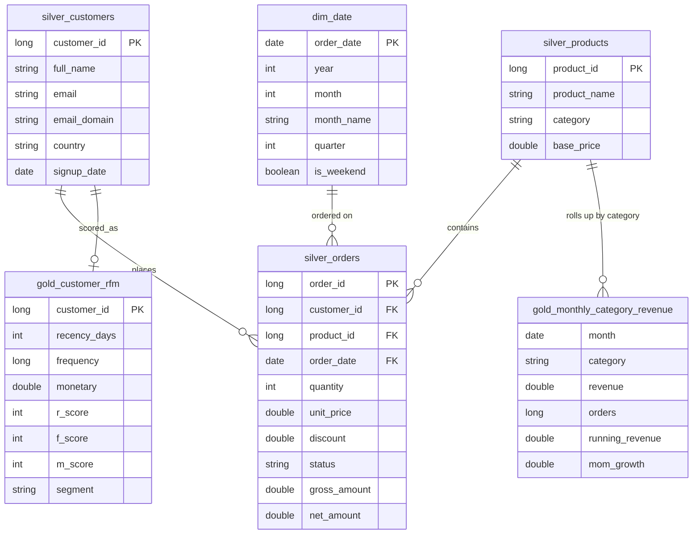
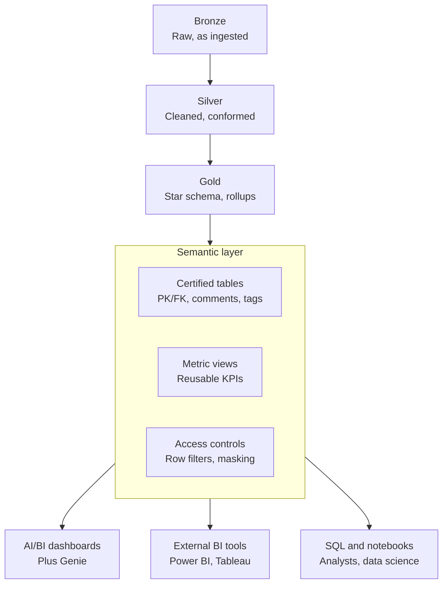

## Databricks Data Transformation Pipeline

- **End-to-end medallion pipeline (bronze → silver → gold)** built on 1M+ synthetic e-commerce orders using Python, PySpark, Spark SQL and SQL
  - Cleaned messy raw data: deduplication with window functions, standardization, and a quarantine table for invalid records
  - Built business-ready aggregates with CTEs, `LAG`/running totals, `QUALIFY` and `NTILE` for RFM customer segmentation

- **Performance optimization with measurable results**
  - Compared Python UDFs, pandas UDFs and built-in functions, and read execution plans to compare broadcast vs sort-merge joins
  - Diagnosed data skew and applied salting; improved Delta file layout with `OPTIMIZE` and liquid clustering

- **Reporting-ready data model and semantic layer:** star schema with PK/FK constraints, documented tables, and governed KPI definitions through Unity Catalog metric views

- **Production practices:** incremental upserts with Delta `MERGE`, time travel, and automated data-quality assertions

- ## Data model (star schema)

## Semantic layer flow

